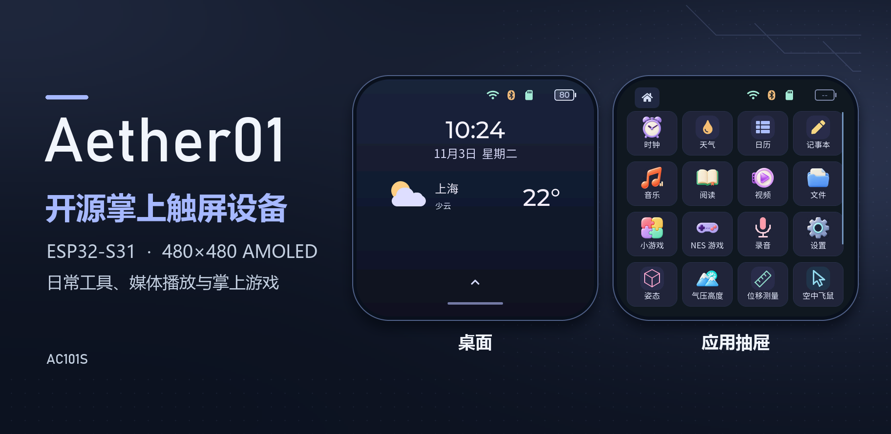
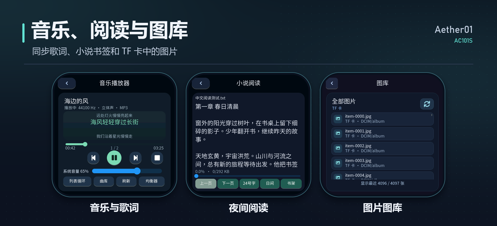
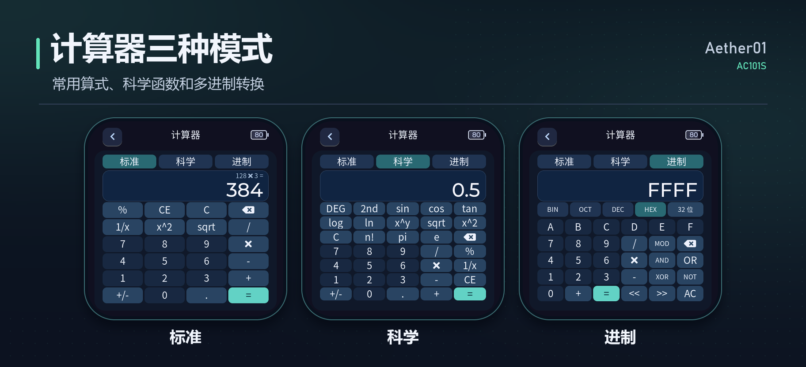
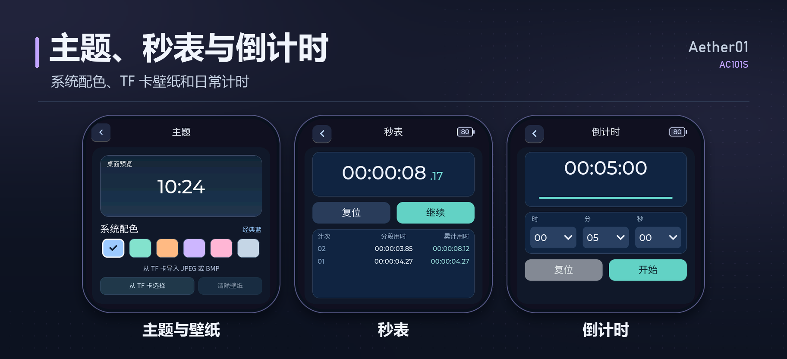
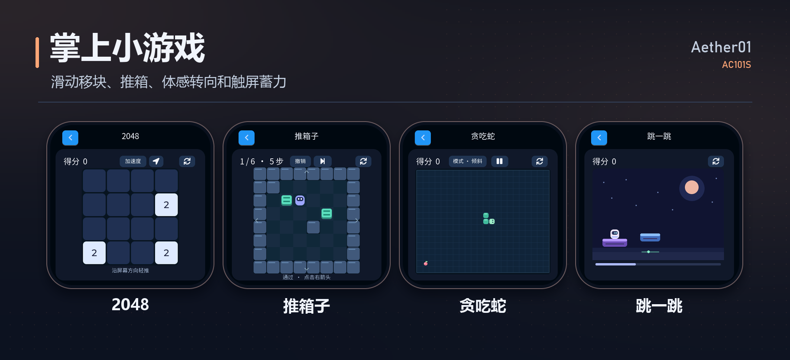
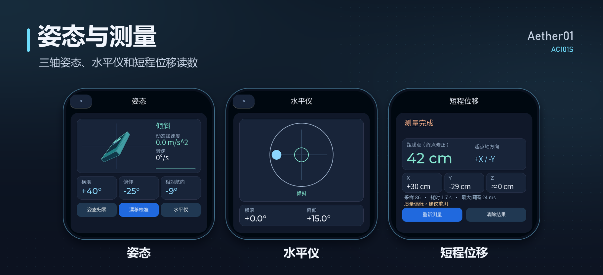
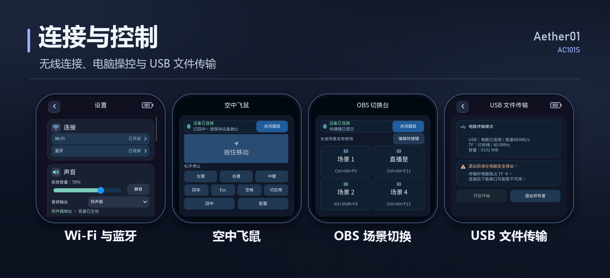

# 以太01（Aether01）AC101S 版硬件

以太01是一款基于 ESP32-S31 的掌上设备，采用 AMOLED 触摸屏、TF 卡和板载音频。本仓库收录 **AC101S 音频硬件版**的设计资料。原版电路设计由 **DarkThunder** 完成，原版外壳由 **Addictionpoi** 设计。

[下载完整资料（ZIP）](https://github.com/DT-DT001/Aether01-Hardware-AC101S/archive/refs/heads/main.zip) · [下载 AC101S 固件](https://github.com/DT-DT001/Aether01-AC101S-/releases) · [AC101S 固件源码](https://github.com/DT-DT001/Aether01-AC101S-#readme) · [许可与署名](NOTICE.md)

## 固件界面

实用工具与连接界面

图中的 480 × 480 屏幕画面由 [V1.2.1 固件](https://github.com/DT-DT001/Aether01-AC101S-/releases/tag/V1.2.1)的 LVGL 界面渲染，内容使用演示数据。

[查看以太01实物外观参考照片](<硬件资料（AC101S）/成品图/斜俯视亮屏.png>)

## 设计文件

| 资料 | 文件 |
| --- | --- |
| 可编辑电路工程 | [嘉立创 EDA 专业版工程](<硬件资料（AC101S）/工程文件/ProDoc_DT_Aether01(AC101S).epro2>) |
| 原理图与 PCB 图纸 | [原理图 PDF](<硬件资料（AC101S）/原理图/SCH_DT_Aether01_SCH(AC101S).pdf>) · [PCB PDF](<硬件资料（AC101S）/制造文件/PCB_DT_Aether01_PCB(AC101S).pdf>) |
| 电路板制造与装配 | [Gerber 和钻孔](<硬件资料（AC101S）/制造文件/Gerber_DT_Aether01_PCB(AC101S).zip>) · [BOM](<硬件资料（AC101S）/制造文件/BOM_DT_Aether01(AC101S).xlsx>) · [贴片坐标](硬件资料（AC101S）/制造文件/PickAndPlace_DT_Aether01_PCB_AC101S.xlsx) |
| 共用外壳 | [Creo 装配与零件](3d外壳文件/261113_Aether01_prt.rar) · [STEP](3d外壳文件/261113_Aether01.stp) · [STL](3d外壳文件/261113_Aether01_STL.rar) |
| 装配参考 | [成品图](硬件资料（AC101S）/成品图/) · [半成品图](硬件资料（AC101S）/半成品图/) · [辅料资料](硬件资料（AC101S）/辅料/) · [辅料选型](ACCESSORIES.md) |

在嘉立创 EDA 专业版中，通过「文件 → 导入 → 嘉立创 EDA 专业版」打开 `.epro2`。解压 Creo 压缩包时，保留装配与零件的原目录结构。[嘉立创 EDA 专业版导入说明](https://prodocs.easyeda.com/en/import-export/export-easyeda-pro/)

## 器件选型注意事项

- **电源管理芯片**采用 **TG29-ESP**，采购时请核对完整型号。
- **射频 π 型匹配网络**的器件类型和数值，以原理图器件标注值后方括号内的参数为准。

## 许可

原创电路和外壳设计采用 [CERN-OHL-S-2.0](LICENSES/CERN-OHL-S-2.0.txt)。该许可允许商用，并规定分发设计和实物时的署名及源文件义务。参考图、供应商资料和第三方 EDA 库的权利说明见 [NOTICE.md](NOTICE.md)。
